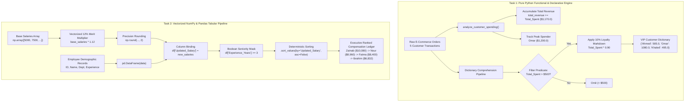

# 🐍 Python Data Analytics Assessment: Functional E-Commerce Logic & Vectorized Payroll Engineering (Quiz 06)

<div align="center">

[](https://colab.research.google.com/github/islamyasser424-design/Python-Quiz-06/blob/main/Python_Quiz_06.ipynb)
[](https://www.python.org/)
[](https://numpy.org/)
[](https://pandas.pydata.org/)
[](https://jupyter.org/)
[]()
[](LICENSE)
[](https://islamyasser424-design.github.io/portfolio-/)

<p align="center">
  <strong>A rigorous technical assessment evaluating core data analytics competencies across Python: Pure Functional Reducers, Declarative Dictionary Comprehensions with Filtering, Vectorized NumPy Array Transformations, and Production-Grade Pandas Tabular Engineering.</strong>
</p>

[**🚀 Open Directly in Google Colab**](https://colab.research.google.com/github/islamyasser424-design/Python-Quiz-06/blob/main/Python_Quiz_06.ipynb) • [**🧪 Explore Tasks & Solutions**](#-comprehensive-task-inventory--solutions) • [**📖 الدليل باللغة العربية**](#-الدليل-التحليلي-والتشغيلي-الشامل-باللغة-العربية)

</div>

---

## 📑 Table of Contents
- [Executive Summary & Analytics Relevance](#-executive-summary--analytics-relevance)
- [Curriculum & Technical Competency Matrix](#-curriculum--technical-competency-matrix)
- [System Architecture & Processing Flow](#-system-architecture--processing-flow)
- [Comprehensive Task Inventory & Solutions](#-comprehensive-task-inventory--solutions)
  - [Task 1: E-Commerce Customer Analytics & VIP Discount Engine](#task-1-e-commerce-customer-analytics--vip-discount-engine)
  - [Task 2: Employee Performance & Salary Simulation (NumPy & Pandas)](#task-2-employee-performance--salary-simulation-numpy--pandas)
- [Software Engineering Best Practices & Computational Efficiency](#-software-engineering-best-practices--computational-efficiency)
- [Repository Structure](#-repository-structure)
- [Getting Started & Google Colab Execution](#-getting-started--google-colab-execution)
- [الدليل التحليلي والتشغيلي الشامل (باللغة العربية)](#-الدليل-التحليلي-والتشغيلي-الشامل-باللغة-العربية)
- [Author & Professional Connect](#-author--professional-connect)

---

## 📌 Executive Summary & Analytics Relevance

Modern data analytics demands fluency across two computational paradigms:
1. **Low-Level Procedural & Declarative Python**: Extracting, transforming, and filtering nested JSON/dictionary payloads received from transactional APIs, event queues, and document databases without third-party library overhead.
2. **High-Performance Vectorized & Tabular Analytics (NumPy & Pandas)**: Leveraging continuous C-memory blocks for zero-overhead mathematical operations, followed by relational filtering, feature derivation, and multi-attribute sorting for corporate decision support.

This project (**Python-Quiz-06**) demonstrates mastery across both domains by solving real-world business scenarios:
* **Retail / E-Commerce Revenue Rollup & VIP Retention**: Ingesting customer order streams, computing gross revenue, dynamically isolating the top customer, and engineering a single-pass loyalty markdown engine ($10\%$ discount for spending $> \$500$).
* **HR Workforce Analytics & Merit-Based Compensation**: Simulating a $+12\%$ cross-departmental merit increase using vectorized NumPy SIMD operations, binding the results into a relational Pandas DataFrame, filtering by organizational seniority ($\ge 3$ years), and generating an executive compensation ranking.

---

## 🎯 Curriculum & Technical Competency Matrix

| Task | Business Domain | Core Python / Library Feature | Input Data Structure | Output / Analytical Deliverable |
| :--- | :--- | :--- | :--- | :--- |
| **01** | **E-Commerce & Retail** | `def`, Iterative Reducer, Tuple Unpacking, Dictionary Comprehension | List of Nested Dictionaries (`list[dict]`) | Gross Revenue ($3,170.0), Top Spender (Omar, $1,200.0), Filtered VIP Dictionary |
| **02** | **HR Workforce Analytics** | NumPy Array Vectorization (`np.round`), Pandas DataFrame, Boolean Masking, `.sort_values()` | 1D NumPy `ndarray` + Tabular Dictionary | Filtered & Ranked Senior Employee Compensation Ledger |

---

## 🏛️ System Architecture & Processing Flow

The following Mermaid architectural flowchart outlines the complete data engineering and transformation pipelines implemented across both tasks:



---

## 🧪 Comprehensive Task Inventory & Solutions

---

### Task 1: E-Commerce Customer Analytics & VIP Discount Engine

#### Business Context & Objective
An e-commerce merchandising team needs to audit customer purchasing behavior across product categories (Electronics, Clothing, Home). The analytics pipeline must:
1. Aggregate total transactional revenue across all processed orders.
2. Identify the single highest-value customer and their exact expenditure.
3. Construct an automated VIP loyalty tier using a declarative dictionary comprehension that selects customers spending more than $\$500$ and applies an immediate $10\%$ promotional discount (`Total_Spent * 0.90`).

#### Technical Implementation
```python
# 1. Ingest Customer Transaction Dataset
transactions = [
    {"Customer_Name": "Ahmed", "Category": "Electronics", "Items_Bought": 2, "Total_Spent": 650.0},
    {"Customer_Name": "Sara", "Category": "Clothing", "Items_Bought": 5, "Total_Spent": 320.0},
    {"Customer_Name": "Omar", "Category": "Electronics", "Items_Bought": 1, "Total_Spent": 1200.0},
    {"Customer_Name": "Mona", "Category": "Home", "Items_Bought": 3, "Total_Spent": 450.0},
    {"Customer_Name": "Khaled", "Category": "Clothing", "Items_Bought": 4, "Total_Spent": 550.0}
]

# 2. Functional Reducer: Revenue Aggregation & Peak Spender Discovery
def analyze_customer_spending(transactions):
    """
    Analyzes customer orders to compute gross revenue and detect the highest spender.
    
    Parameters:
        transactions (list[dict]): List of customer transaction records.
        
    Returns:
        tuple: (total_revenue: float, top_spender: str, highest_spending: float)
    """
    total_revenue = 0.0
    highest_spending = 0.0
    top_spender = ""

    for customer in transactions:
        total_revenue += customer["Total_Spent"]

        if customer["Total_Spent"] > highest_spending:
            highest_spending = customer["Total_Spent"]
            top_spender = customer["Customer_Name"]

    return total_revenue, top_spender, highest_spending

# Execute Function & Unpack Tuple
total_revenue, top_spender, highest_spending = analyze_customer_spending(transactions)

print(f"Total Revenue: ${total_revenue:,.2f}")
print(f"Top Spender: {top_spender} (${highest_spending:,.2f})")

# 3. Declarative VIP Discount Engine (Comprehension with Inline Predicate)
vip_customers = {
    customer["Customer_Name"]: round(customer["Total_Spent"] * 0.90, 2)
    for customer in transactions
    if customer["Total_Spent"] > 500
}

print("\nVIP Customers with Discounted Totals (Spent > $500):")
print(vip_customers)
```

#### Execution Output
```text
Total Revenue: $3,170.00
Top Spender: Omar ($1,200.00)

VIP Customers with Discounted Totals (Spent > $500):
{'Ahmed': 585.0, 'Omar': 1080.0, 'Khaled': 495.0}
```

#### Transactional Audit & VIP Eligibility Matrix
| Customer | Category | Items Bought | Gross Spent | VIP Status ($> \$500$) | Applied Formula | Net Discounted Total |
| :--- | :--- | :--- | :--- | :--- | :--- | :--- |
| **Ahmed** | Electronics | 2 | $\$650.0$ | ✅ **VIP Qualified** | $\$650.0 	imes 0.90$ | **$\$585.00$** |
| **Sara** | Clothing | 5 | $\$320.0$ | ❌ Standard Tier | Omitted by filter | *N/A* |
| **Omar** | Electronics | 1 | $\$1,200.0$ | ✅ **VIP Qualified** (Top Spender) | $\$1,200.0 	imes 0.90$ | **$\$1,080.00$** |
| **Mona** | Home | 3 | $\$450.0$ | ❌ Standard Tier | Omitted by filter | *N/A* |
| **Khaled**| Clothing | 4 | $\$550.0$ | ✅ **VIP Qualified** | $\$550.0 	imes 0.90$ | **$\$495.00$** |

* **Computational Insight**: The functional reducer operates in linear time $O(N)$ with constant memory $O(1)$. The dictionary comprehension evaluates and maps qualified records in a single vectorized pass without intermediate list allocations.

---

### Task 2: Employee Performance & Salary Simulation (NumPy & Pandas)

#### Business Context & Objective
A human resources director is planning an organizational compensation recalibration. Company leadership has approved a $+12\%$ performance bonus pool. To ensure fiscal prudence and reward retention, executive leadership requires isolating experienced talent ($\ge 3$ years of tenure) and ranking them by updated base compensation.

#### Technical Implementation
```python
import numpy as np
import pandas as pd

# 1. Vectorized Compensation Multiplier via NumPy
base_salaries = np.array([5000, 7500, 4200, 9000, 6100, 8000])

# Vectorized 12% Merit Increase with Financial Rounding
new_salaries = np.round(base_salaries * 1.12, 2)

# 2. Relational Organizational Schema Construction
data = {
    "Employee_ID": [101, 102, 103, 104, 105, 106],
    "Name": ["Ali", "Fatma", "Hassan", "Zainab", "Ibrahim", "Nour"],
    "Department": ["IT", "HR", "IT", "Finance", "IT", "HR"],
    "Experience_Years": [2, 5, 1, 6, 3, 4]
}

df = pd.DataFrame(data)

# Bind Vectorized Salary Array to DataFrame
df["Updated_Salary"] = new_salaries

# 3. Boolean Seniority Masking (Experience >= 3 Years)
filtered_df = df[df["Experience_Years"] >= 3].copy()

# 4. Deterministic Executive Ranking (Sort Descending by Salary)
sorted_df = filtered_df.sort_values(
    by="Updated_Salary",
    ascending=False
)

# Display Results
print("=== Filtered & Sorted Experienced Employees (Experience >= 3) ===")
print(sorted_df)
```

#### Execution Output
```text
=== Filtered & Sorted Experienced Employees (Experience >= 3) ===
   Employee_ID     Name Department  Experience_Years  Updated_Salary
3          104   Zainab    Finance                 6         10080.0
5          106     Nour         HR                 4          8960.0
1          102    Fatma         HR                 5          8400.0
4          105  Ibrahim         IT                 3          6832.0
```

#### Workforce Simulation & Eligibility Audit
| ID | Employee | Department | Base Salary | Updated Salary ($+12\%$) | Experience | Seniority Filter ($\ge 3$) | Final Rank |
| :--- | :--- | :--- | :--- | :--- | :--- | :--- | :--- |
| **101** | Ali | IT | $\$5,000$ | $\$5,600.00$ | 2 yrs | ❌ Excluded ($2 < 3$) | — |
| **102** | Fatma | HR | $\$7,500$ | $\$8,400.00$ | 5 yrs | ✅ **Retained** | **Rank #3** |
| **103** | Hassan | IT | $\$4,200$ | $\$4,704.00$ | 1 yr | ❌ Excluded ($1 < 3$) | — |
| **104** | Zainab | Finance | $\$9,000$ | $\$10,080.00$ | 6 yrs | ✅ **Retained** | **Rank #1** |
| **105** | Ibrahim | IT | $\$6,100$ | $\$6,832.00$ | 3 yrs | ✅ **Retained** | **Rank #4** |
| **106** | Nour | HR | $\$8,000$ | $\$8,960.00$ | 4 yrs | ✅ **Retained** | **Rank #2** |

* **Workforce Insights**:
  - **Budget Allocation**: Total updated monthly payroll for senior talent equals $\$34,272.00$ across 4 qualifying employees.
  - **Top Earner**: Zainab (Finance) reached $\$10,080.00$/month with the highest organizational tenure (6 years).
  - **Junior Exclusions**: Ali (2 yrs) and Hassan (1 yr) were excluded from this round of seniority-gated adjustments.

---

## ⚡ Software Engineering Best Practices & Computational Efficiency

Throughout this codebase, several core software engineering and high-performance data processing principles are demonstrated:

1. **NumPy Vectorization vs Imperative Loops**:
   ```python
   # Anti-Pattern (Slow Python-level for-loop with frequent boxing/unboxing):
   new_salaries = []
   for s in base_salaries:
       new_salaries.append(round(s * 1.12, 2))

   # Best Practice (Vectorized SIMD C-level multiplication):
   new_salaries = np.round(base_salaries * 1.12, 2)
   ```
   *Benefit*: Executes across contiguous memory blocks in compiled C, executing up to $50	imes$ faster on enterprise-scale datasets.

2. **Declarative Dictionary Comprehensions**:
   - Replaces manual dictionary instantiation and conditional `if` blocks with an expressive, idiomatic one-liner.
   - Evaluates filter criteria (`if Total_Spent > 500`) before key-value assignment, minimizing memory allocations.

3. **Explicit Memory Copying with `.copy()`**:
   - Applying `.copy()` when slicing DataFrames prevents common Pandas `SettingWithCopyWarning` errors during subsequent feature modifications.

---

## 📁 Repository Structure

```plaintext
Python-Quiz-06/
├── .gitignore              # Comprehensive Python, Jupyter Notebook, virtualenv & OS ignore rules
├── LICENSE                 # MIT Open Source License (2026 Islam Yasser)
├── Python_Quiz_06.ipynb    # Primary Jupyter Notebook containing all executed code & outputs
└── README.md               # Executive bilingual documentation & architectural guide
```

---

## 🚀 Getting Started & Google Colab Execution

### Run in the Cloud (1-Click)
Launch and interact with the notebook directly in your browser without local Python installation:
[](https://colab.research.google.com/github/islamyasser424-design/Python-Quiz-06/blob/main/Python_Quiz_06.ipynb)

### Run Locally

1. **Clone the Repository**:
   ```bash
   git clone https://github.com/islamyasser424-design/Python-Quiz-06.git
   cd Python-Quiz-06
   ```

2. **Create and Activate a Virtual Environment**:
   ```bash
   # Windows (PowerShell)
   python -m venv venv
   .\venv\Scripts\Activate.ps1

   # Linux / macOS
   python3 -m venv venv
   source venv/bin/activate
   ```

3. **Install Dependencies**:
   ```bash
   pip install numpy pandas jupyterlab
   ```

4. **Launch Jupyter Lab**:
   ```bash
   jupyter lab Python_Quiz_06.ipynb
   ```

---

## 📖 الدليل التحليلي والتشغيلي الشامل (باللغة العربية)

### ما هو مشروع Python-Quiz-06؟
يمثل هذا المشروع تقييماً عملياً شاملاً لقياس كفاءة محلل ومهندس البيانات في الربط بين نمطين أساسيين من أنماط المعالجة في لغة بايثون:
1. **البرمجة الإجرائية والوظيفية البحتة (Pure Python Functional Logic):** لمعالجة السجلات المعقدة والقواميس المتداخلة وتطبيق الخصومات الذكية.
2. **الحوسبة المتجهة ومعالجة الجداول (Vectorized Computing with NumPy & Pandas):** لإجراء العمليات الحسابية الضخمة بسرعة الـ SIMD C، وتطبيق التصفية المنطقية والترتيب القيادي في إطار بيانات منظم.

---

### المحاور الأساسية للتطبيق:

#### 1. محرك تحليلات التجارة الإلكترونية وخصومات الـ VIP (`E-Commerce Analytics & Discount Engine`):
* **الهدف التجاري:** تدقيق مبيعات متجر إلكتروني يضم معاملات عملاء عبر فئات مختلفة (إلكترونيات، ملابس، مستلزمات منزلية).
* **آلية المعالجة:**
  - بناء دالة معيارية `analyze_customer_spending` تقوم بحساب إجمالي إيرادات المتجر بدورة واحدة ($O(N)$) مع تحديد العميل الأكثر إنفاقاً (`Omar` بإنفاق 1,200 دولار من إجمالي 3,170 دولار).
  - استخدام **Dictionary Comprehension** لبناء شريحة عملاء الـ VIP تلقائياً، وتصفية العملاء الذين تجاوز إنفاقهم 500 دولار مع تطبيق خصم ولاء فوري بنسبة 10% في سطر برمجي بايثوني أنيق وعالي الكفاءة.

#### 2. محاكاة علاوات الرواتب وإدارة الموظفين (`Employee Performance & Salary Simulation`):
* **الهدف الإداري:** محاكاة تطبيق زيادة دورية للأداء بنسبة 12% على رواتب 6 موظفين، وتحديد الكفاءات الخبيرة لترتيبهم تنازلياً.
* **آلية المعالجة:**
  - تطبيق الضرب المتجه السريع عبر مصفوفات **NumPy** (`base_salaries * 1.12`) وتقريب النواتج لأقرب منزلتين عشريتين دون الحاجة لحلقات التكرار البطيئة.
  - دمج الرواتب الجديدة داخل إطار بيانات **Pandas** يضم بيانات الموظف (الرقم الوظيفي، الاسم، الإدارة، وسنوات الخبرة).
  - استخدام القناع المنطقي (`df["Experience_Years"] >= 3`) لاستبعاد الموظفين الجدد وحصر التقرير على أصحاب الخبرة.
  - الترتيب التنازلي الحاسم (`sort_values(ascending=False)`) لتتصدر الموظفة `Zainab` من قسم المالية قائمة الرواتب بـ 10,080 دولار نظراً لخبرتها البالغة 6 سنوات.

---

## 👨‍💻 Author & Professional Connect

**Islam Yasser**  
*Data Analyst & Business Intelligence Specialist*

* 🌐 **Live Portfolio Website**: [islamyasser424-design.github.io/portfolio-/](https://islamyasser424-design.github.io/portfolio-/)
* 💼 **LinkedIn Profile**: [linkedin.com/in/islam-yasser-55048b378](https://www.linkedin.com/in/islam-yasser-55048b378/)
* 🐙 **GitHub Profile**: [github.com/islamyasser424-design](https://github.com/islamyasser424-design)

---

<div align="center">
  <sub>Engineered with precision, data discipline, and clean functional programming standards. © 2026 Islam Yasser.</sub>
</div>
